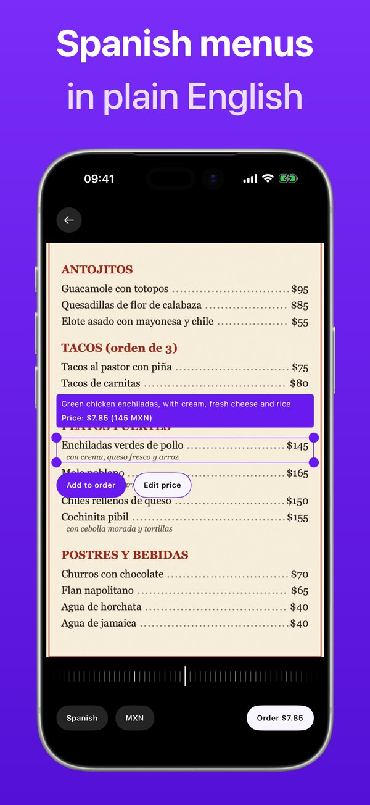
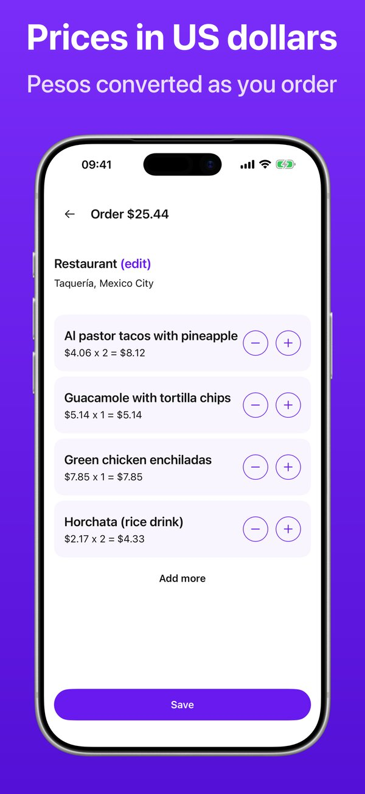
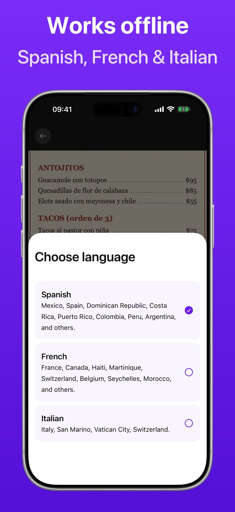
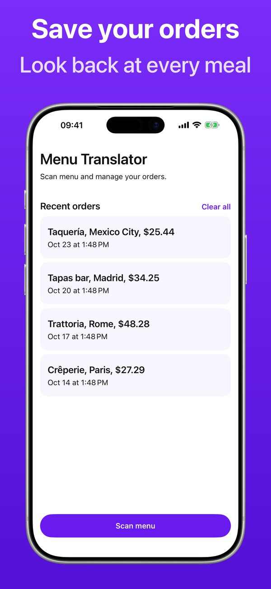

# Menu Translator to English

An iPhone and iPad app for travelers: take a photo of a restaurant menu, frame a dish, and read it in English with its price in US dollars. Built for Spanish menus and Mexican pesos first; French and Italian menus and their local currencies work too.

  
  
  
  

## Features

- **Menu translation**: Spanish, French and Italian to English, with Apple's on-device Translation framework.
- **Prices in US dollars**: menu prices in pesos, euros and other local currencies converted to USD, shown next to the original ("$7.85 (145 MXN)").
- **Works offline**: text recognition and translation run on the device once a language is downloaded; exchange rates refresh when online and the last saved rates are used offline.
- **Orders**: add dishes, adjust quantities, name the restaurant and save orders on the device.

## License

[MIT](LICENSE.txt)
